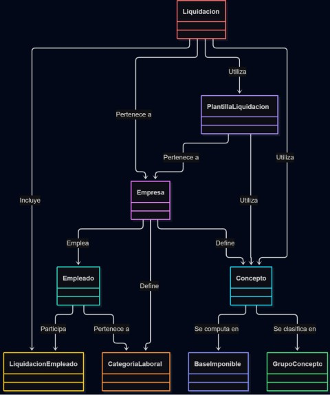
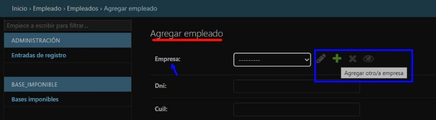
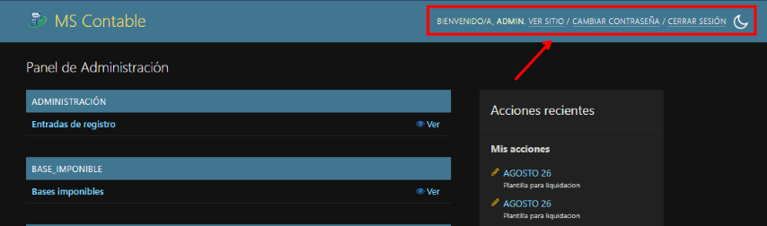
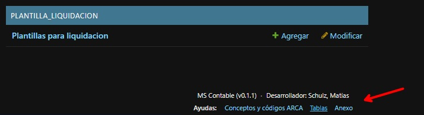
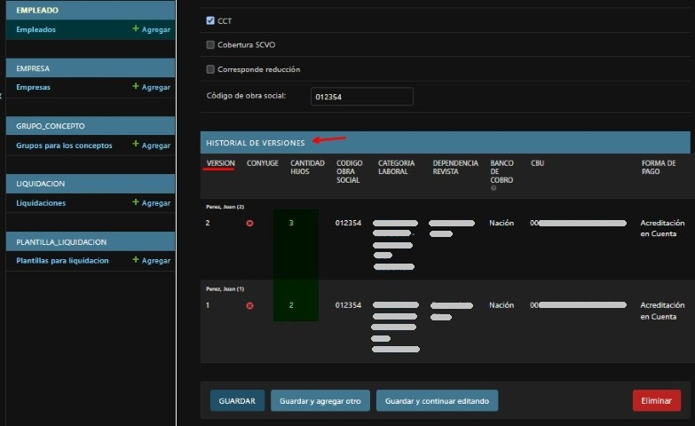
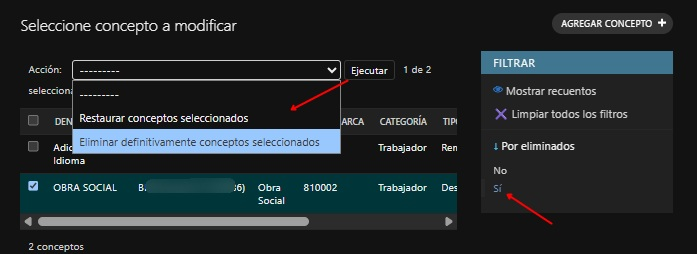
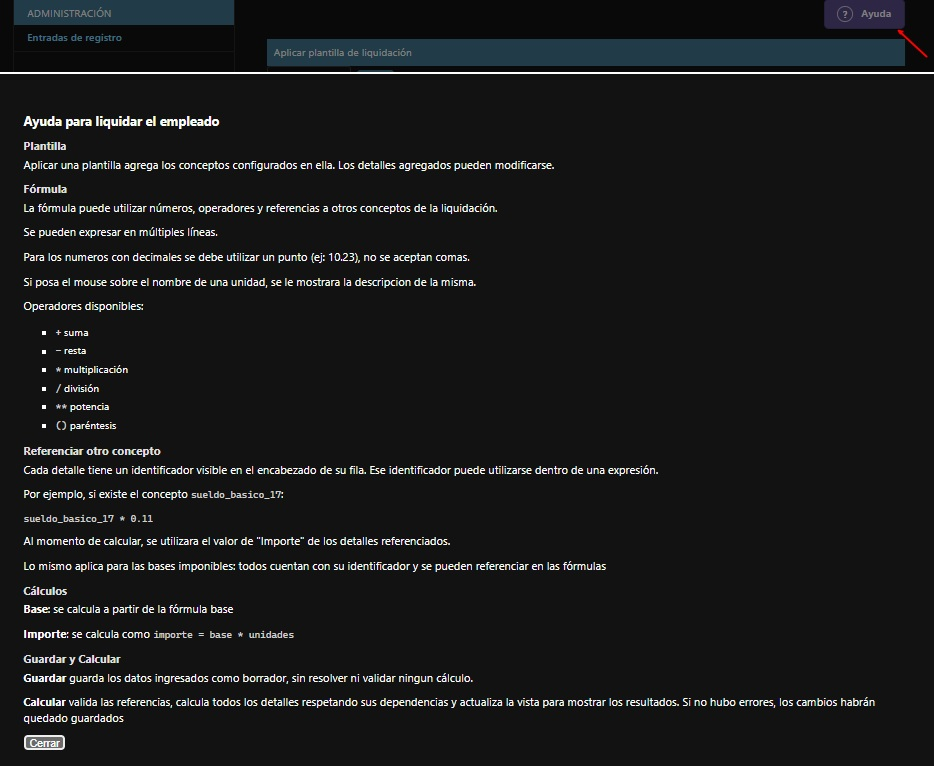
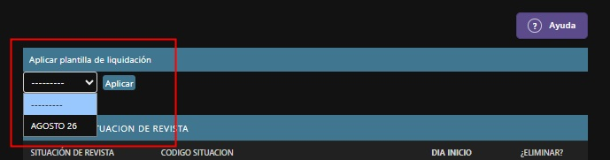
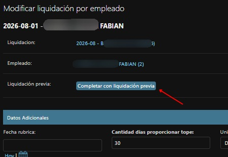
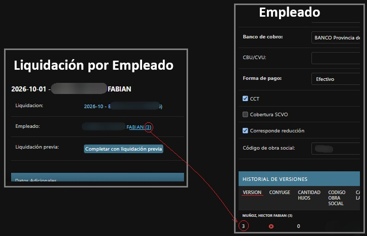

# Manual de Usuario - MS Contable

Este manual de usuario está apuntado a explicar el funcionamiento y forma de uso del sistema MS Contable.

## Instalación

[Acá](https://github.com/SMati000/ms_contable/releases) se encuentran todas las versiones disponibles junto con los artefactos de instalación para Sistemas Operativos Windows y Linux. En el mismo se encuentran las instrucciones a seguir (`install.md`) para realizar la instalación.

## Generalidades

Las entidades del sistema estan relacionadas como se muestra en el esquema de abajo, por lo que se recomienda cargarlas en este órden: empresa, categorías laborales, empleados, grupos para los conceptos, conceptos, plantillas de liquidación, liquidación.

Al interactuar con cada entidad, se puede también interactuar con las entidades asociadas. Ejemplo: mientras se crea un empleado, se permite crear o editar la empresa asociada.

En el menú superior derecho, se encuentran las opciones: cambiar contraseña, cerrar sesión y cambiar entre modo claro/oscuro.

En el pie de página se encuentra información útil para el momento de cargar ciertos datos.

En la sección "Entradas de Registro", se puede observar un historial de las acciones realizadas: creación, edición y/o eliminación de conceptos, empleados, etc.

## Carga de Datos

#### Versionado

Al acceder a un concepto o empleado, se permite editar ciertos datos mientras que otros son inmutables una vez creados.

Cada vez que se editen los datos de un concepto o empleado, se guarda la versión con los datos previos. Se puede ver el historial de versiones
en el apartado inferior.

#### Eliminar y Restaurar

En el caso de los conceptos, una vez eliminados se puede seguir accediendo a ellos y eliminarlos definitivamente o restaurarlos.

Si un concepto fue utilizado en alguna liquidación no se permitira eliminarlo definitivamente.

## Liquidación de Sueldos

Al cargar una liquidación, tener en cuenta:
- Las liquidaciones solo permiten períodos mensuales.
- El período debe comenzar el primer día del mes.
- La fecha de pago puede ser del mismo mes que el período, o del mes siguiente.

Dentro de la liquidación se podrán cargar las liquidaciones por cada empleado de forma individual.

Al crear una liquidación por empleado se deben cargar:
- Los datos de la sección "detalles adicionales", mayormente utilizados para la creación del TXT para el LSD de Arca.
- Las observaciones, si fuera pertinente.
- Los tramos de situación de revista.
- El importe de las Detracciones en la sección "Bases Imponibles".
- Los detalles de la liquidación, donde cada uno estará asociado a un concepto y se le establecerá el importe que corresponda. 

Al utilizar la opción "Guardar" en la liquidación por empleado, no se validan ni se realizan los calculos. Para esto último, se debe utilizar la opción "Calcular", que además de guardar los datos ingresados, realiza los calculos y validaciones correspondientes sobre los mismos.

#### Detalles de Liquidación

Los detalles de la liquidación son propios de cada liquidación por empleado.

Cada detalle de liquidación estará asociado a un concepto.

Se podrán cargar las unidades y fórmula para la base que corresponda. A partir de la fórmula se calculará el número final de base, y el importe del detalle será el resultado de *unidades * base*.

Ejemplo:

| Concepto                 | Unidad     | Unidades |       Fórmula Base |           Base (*) |    Importe (*) |
| ------------------------ | ---------- | -------: | -----------------: | -----------------: | -------------: |
| Sueldo básico            | Cantidad   |       30 |             65.000 |            $65.000 |     $1.950.000 |
| Adicional por antigüedad | Porcentaje |      2 % |      Sueldo Básico |         $1.950.000 |        $39.000 |

*(\*) Calculados automáticamente.*

Si corresponde, en el detalle también se deberan cargar datos requeridos por Arca en su Libro de Sueldos Digital.

Se cuenta con un diálogo de ayuda para asisitir en el uso de fórmulas y otras complejidades de las Liquidaciónes por Empleado.

#### Plantillas de Liquidación

Por lo general, para una misma empresa, los detalles de liquidación de cada empleado serán iguales o muy parecidos incluso a lo largo de múltiples liquidaciones. Para no tener que cargar los detalles de forma repetida en cada liquidación por empleado, se puede hacer uso de las Plantillas de Liquidacion.

Una plantilla contiene simplemente la lista de detalles de liquidación, cada uno con sus unidades, fórmula base y otros datos.

La plantilla estará asociada a una empresa en particular y, al crear una liquidacion para dicha empresa, se podrá utilizar en las liquidaciones de los empleados para cargar automáticamente los detalles de la liquidación.

#### Cargar Datos de Liquidación Anterior

Similar al razonamiento para las plantillas de liquidación, el resto de datos de la liquidación de un empleado probablemente sean similares a los de la liquidación previa de ese empleado.

Por eso, al cargar una liquidación por empleado, esta la opción de rellenar los datos adicionales en base a la liquidación inmediatamente anterior de ese mismo empleado.

Nota: esta opción no contempla los tramos de situación de revista ni el importe para Detracciones. Dichos datos deben ser cargados manualmente en cada Liquidación por Empleado.

#### Estados de la Liquidación

Una liquidación puede encontrarse en uno de los siguientes estados:

* **Borrador**: la liquidación está en proceso de elaboración y puede ser modificada.
* **Cerrada**: al generar del TXT LSD, la liquidación pasa a ser inmutable.
* **Rectificación**: una liquidación previamente cerrada fue reabierta explícitamente para realizar modificaciones sobre sus detalles.

Los recibos de sueldo y el TXT se pueden generar en cualquier estado. Tener en cuenta que, al generar el TXT, la liquidación se cierra auomáticamente.

La liquidación referencia datos de la empresa asociada y, una vez creada, dichos datos no se actualizan incluso si luego se editan los datos de la empresa en cuestión.

En el caso de las liquidaciones por empleado, estas referencian datos del empleado y de los conceptos. Una vez creada la liquidación por empleado, esta queda vinculada a la versión concreta de ese momento del empleado, y no se actualiza aunque se modifiquen los datos del empleado posteriormente.

La liquidación por empleado muestra explícitamente a qué versión del mismo está vinculada.

Bajo la misma lógica, al cargar un detalle de liquidación, la version del concepto asociado permanece fija incluso si posteriormente se modifica dicho concepto.

Para que una Liquidación, Liquidación por Empleado o Detalle de Liquidación actualice sus referencias a la versión más reciente de la entidad vinculada, se debe eliminar y volver a crear.

#### Recibos de Sueldo

Por cada liquidación por Empleado se puede generar el recibo de sueldo original o duplicado. Se muestra una vista previa que permite descargar como PDF o imprimir. Si se modifican datos de la liquidación del empleado, se puede refrescar la vista previa y se actualizará automáticamente, o simplemente se puede cerrar y volver a abrir.

En el recibo de sueldo se mostrarán todos los detalles de liquidación cargados, con sus respectivos valores de unidades, base e importe final. Además, se mostrará la composición salarial desagregada, asi como el costo del empleador en base al tipo de cada concepto (remunerativo, no remunerativo, descuento, contribución).

Sobre el detalle de la composición salarial que se muestra al final del recibo de acuerdo lo requerido por ley, cabe destacar que allí se verán reflejados aquellos detalles de liquidación vinculados a conceptos de tipo "descuento" o "contribución" y agrupados de acuerdo al Grupo para Concepto al que esten asociados. Los Grupos por defecto que estan incorporados en el sistema son los mínimos requeridos por ley, si se utilizaran otros adicionales, en el recibo se reflejarían en el gráfico como "Otros".

## Administración de la Información

En el directorio/carpeta de instalación del sistema, se encontrará una subcarpeta, "data", con un archivo "db.sqlite3". En el mismo se guarda  toda la información cargada en el sistema. Un mal uso de este archivo puede resultar en compartir datos con terceros no deseados y/o en pérdidas de información.

El sistema realiza copias de seguridad automáticas, guardadas en la misma carpeta, cada vez que se realiza una actualización. Estas pueden ser restauradas simplemente deteniendo el sistema y cambiando el nombre del archivo por el mencionado anteriormente.

## Soporte

Reportar problemas [acá](https://github.com/SMati000/ms_contable/issues). Incluir:

* Versión de la aplicación.
* Sistema operativo.
* Versión de Docker.
* Mensaje de error mostrado.
* Salida de **6. Ver estado**.
* Logs relevantes de la aplicación (carpeta "logs" en el directorio de instalación).
